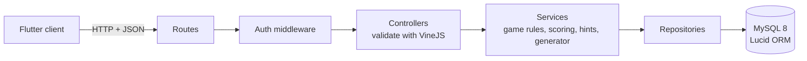
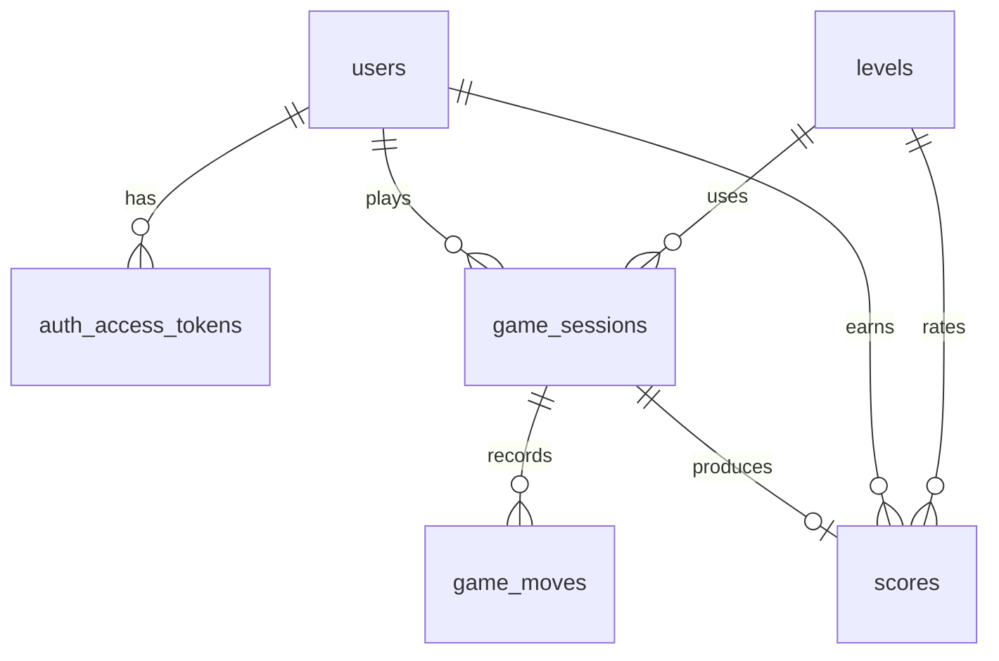
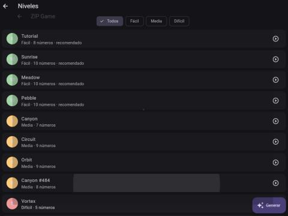
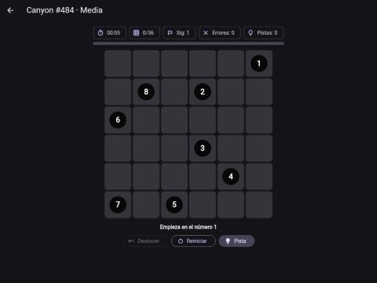
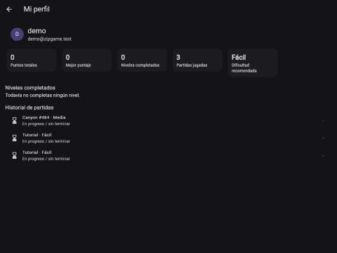

# zip-game-api

REST API for **ZIP Game**, a 6×6 logic puzzle: connect the numbers in ascending order with a single path that visits all 36 cells, with no diagonals and no repeated cells. Built with AdonisJS 6, TypeScript and MySQL 8. The server owns the rules: it validates every solution, computes every score and generates new levels with a guaranteed solution.

The Flutter client lives in [zip-game](https://github.com/alexander-tinoco/zip-game).

---

## Project status

| Indicator | Status |
|---|---|
| **Continuous integration** | [](https://github.com/alexander-tinoco/zip-game-api/actions/workflows/ci.yml) |
| **License** | [](LICENSE) |
| **Tests** | **37** (unit + functional, run against a real MySQL database) |
| **Endpoints** | 13 routes under `/api` |
| **Typing** | `tsc --noEmit` in CI |

University project (UTD, Development for Smart Devices), finished. The technical report, ER diagram and test evidence are in [`docs/`](docs/).

---

## The rule that shapes the design

> The client never decides the result. A path is only worth points after the backend re-validates it.

| Concern | How the server handles it |
|---|---|
| **Solution validation** | Rejects repeated cells, diagonals, missing cells, wrong number order and a wrong start or end (`422`) |
| **Score** | Computed only on the server from time, mistakes and hints; the client cannot send points |
| **Level secrecy** | The stored solution is never serialized to the client |
| **Double scoring** | A finished session returns `409`; the result is saved in a transaction |
| **Ownership** | A player can only see, hint and finish their own sessions |
| **Passwords** | Hashed with scrypt, never returned in JSON |

---

## Advanced features

- **Level generation.** A random Hamiltonian path is built with *backbite* moves, then checkpoints are placed along it, so every generated level is solvable by construction. The base path is re-validated before the level is stored.
- **Difficulty measurement.** A 0–100 score from four objective metrics: average gap between checkpoints, number of possible solutions, search effort without heuristics, and number of turns. It maps to easy, medium or hard.
- **Smart hints.** The server validates the current path and suggests only the next cell, or tells the player to backtrack from a dead end. It never solves the whole puzzle, and each hint costs points.
- **Scoring.** Base 1000 / 2000 / 3000 by difficulty, +3 per second under the target time (120 / 180 / 300 s), −2 per second over it, −25 per mistake, −150 per hint, never below 10% of the base.
- **Adaptive difficulty.** Each finished game is rated excellent, normal or poor. Over the last three games, two excellent ones raise the recommended difficulty and two poor ones lower it. It only affects future games, never one in progress.

---

## Architecture



Controllers only receive, validate and delegate. Rules live in services. Queries live in repositories.

```
app/
├── controllers/    auth, levels, games, leaderboard, users
├── services/       game, game_validator, path_solver, level_generator,
│                   hint, scoring, adaptive_difficulty, leaderboard
├── repositories/   user, level, game_session, score
├── validators/     VineJS schemas
├── middleware/     token authentication, JSON responses
├── models/         user, level, game_session, game_move, score
└── utils/          board helpers, seeded random, presenters
database/
├── migrations/     six tables, created from code
└── seeders/        demo levels and a demo player
tests/              unit and functional (Japa)
docs/               report, ER diagram, screenshots, test evidence
```

---

## Data model



Cells are numbered `0..35` (`index = row × 6 + column`), and boards are stored as JSON lists. A static version is in [`docs/er_diagrama.svg`](docs/er_diagrama.svg).

---

## API

| Method | Route | Auth | Purpose |
|---|---|---|---|
| `POST` | `/api/auth/register` | no | Create a player |
| `POST` | `/api/auth/login` | no | Sign in, returns a token |
| `POST` | `/api/auth/logout` | yes | Revoke the token |
| `GET` | `/api/levels` | yes | List levels (without solutions) |
| `GET` | `/api/levels/:id` | yes | One level |
| `POST` | `/api/levels/generate` | yes | Generate a level with a guaranteed solution |
| `POST` | `/api/games` | yes | Start a game |
| `GET` | `/api/games/history` | yes | The player's finished games |
| `GET` | `/api/games/:id` | yes | One game |
| `POST` | `/api/games/:id/hint` | yes | Smart hint |
| `POST` | `/api/games/:id/finish` | yes | Validate the path and score it |
| `GET` | `/api/leaderboard` | no | Ranking by summed best score per level |
| `GET` | `/api/users/me` | yes | Profile and stats |

Status codes: `200`/`201` success, `400` bad credentials, `401` missing or invalid token, `404` not found or not yours, `409` game already finished, `422` validation error or invalid solution.

---

## Running it

Requires Node.js 20+ and MySQL 8 (or Docker).

```bash
git clone https://github.com/alexander-tinoco/zip-game-api.git
cd zip-game-api
npm install
cp .env.example .env
node ace generate:key
```

Create the databases and a user (replace the password, then put it in `DB_PASSWORD`):

```bash
docker run -d --name zipgame-mysql -e MYSQL_ROOT_PASSWORD=change-me -p 127.0.0.1:3306:3306 mysql:8.0
mysql -h 127.0.0.1 -uroot -p < database/sql/01_create_database.sql
```

Then:

```bash
node ace migration:run
node ace db:seed        # demo levels + demo@zipgame.test / demo12345
node ace serve --hmr    # http://localhost:3333
```

Reset to clean data at any time with `node ace migration:fresh --seed`.

## Tests

```bash
echo "NODE_ENV=test
DB_DATABASE=zip_game_test" > .env.test
node ace test
```

Tests run against the `zip_game_test` database. Saved runs are in [`docs/evidence/`](docs/evidence/).

---

## Screenshots

| Levels | Board | Profile |
|---|---|---|
|  |  |  |

## License

[MIT](LICENSE)
