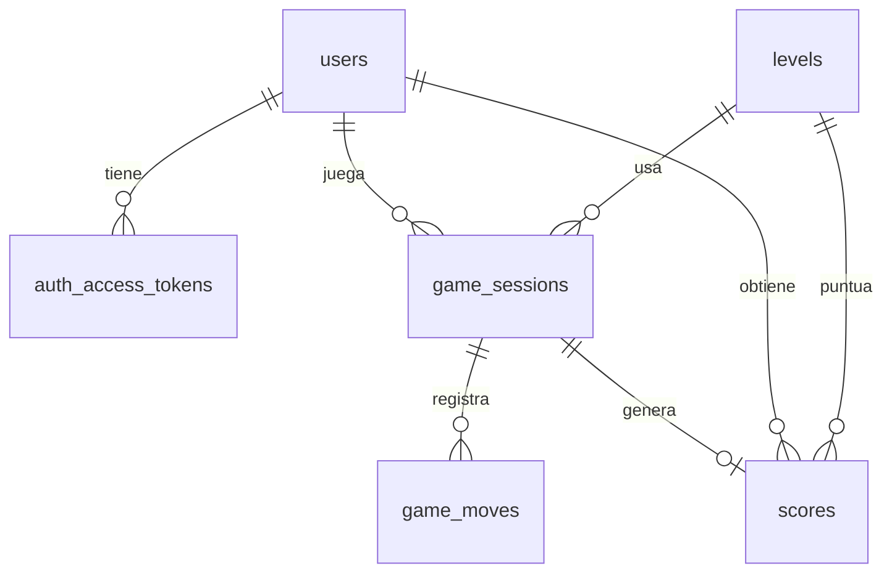

# ZIP Game API (AdonisJS 6 + MySQL 8)

Backend REST del juego ZIP Game. Valida caminos, calcula puntajes y guarda resultados en el servidor.

## Requisitos
Node.js 20+, MySQL 8.

## Instalación
```bash
npm install
cp .env.example .env        # poner DB_PASSWORD
node ace generate:key
# crear las bases zip_game y zip_game_test y el usuario zip_user (ver database/sql/01_create_database.sql)
node ace migration:run
node ace db:seed            # niveles de demostración + demo@zipgame.test / demo12345
node ace serve --hmr        # http://localhost:3333
```
Pruebas: `node ace test` (usa `.env.test` con la base `zip_game_test`).

## Diagrama entidad-relación


## Endpoints
| Método | Ruta | Auth | Descripción |
|---|---|---|---|
| POST | /api/auth/register | no | Registro |
| POST | /api/auth/login | no | Login, devuelve token |
| POST | /api/auth/logout | sí | Cierra sesión |
| GET | /api/levels | sí | Niveles (sin solución) |
| GET | /api/levels/:id | sí | Un nivel |
| POST | /api/levels/generate | sí | Genera nivel con solución garantizada |
| POST | /api/games | sí | Inicia partida |
| GET | /api/games/history | sí | Historial propio |
| GET | /api/games/:id | sí | Detalle de partida |
| POST | /api/games/:id/hint | sí | Pista inteligente |
| POST | /api/games/:id/finish | sí | Valida solución y puntúa |
| GET | /api/leaderboard | no | Ranking |
| GET | /api/users/me | sí | Perfil |

Códigos: 200/201 éxito, 400 credenciales, 401 sin token, 404 no existe, 409 partida ya terminada, 422 validación o solución inválida.

## Seguridad
Contraseñas con hash, tokens de acceso, validación VineJS, puntaje solo en servidor, transacciones al guardar, `.env` fuera de Git.
